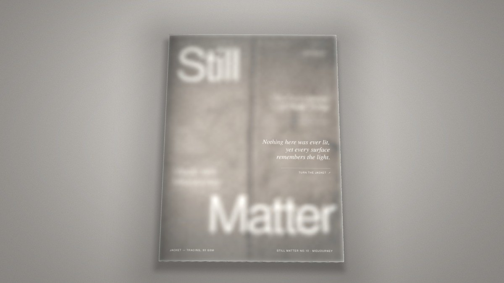
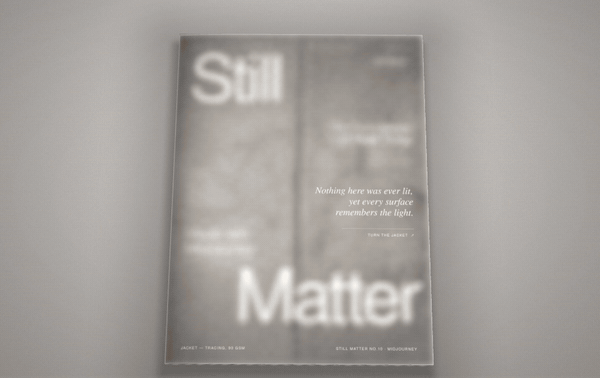
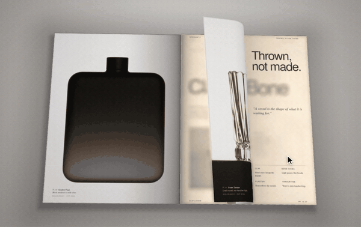
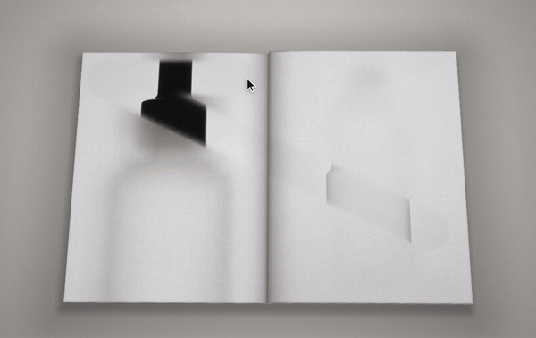
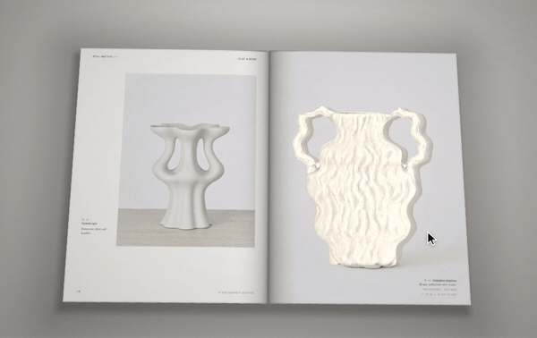
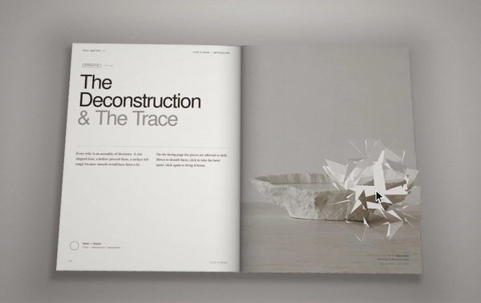
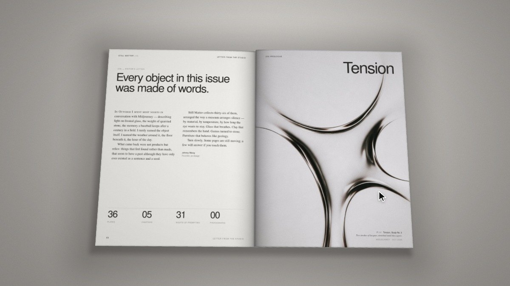
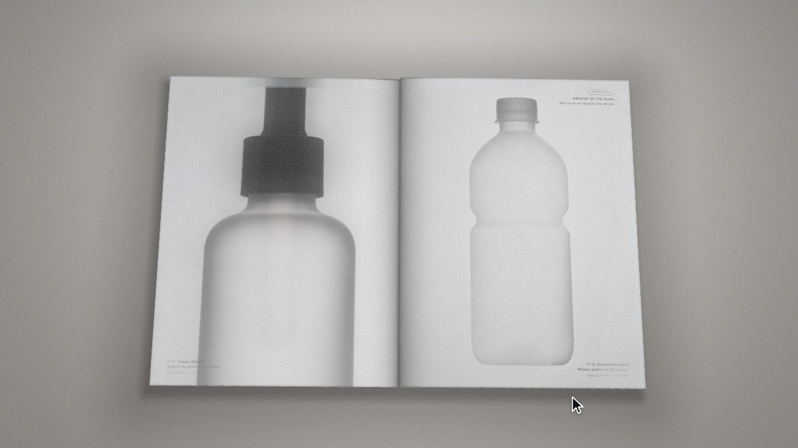
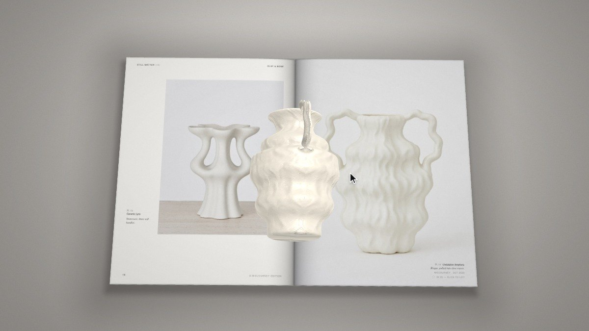
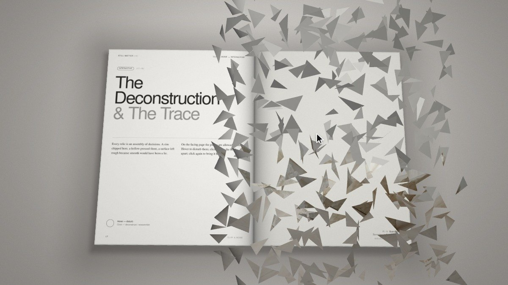

# Still Matter — Issue 10

**A WebGL flip magazine about objects, light and the quiet weight of things.**
Still Matter · Issue 10 · October 2026 — designed by **jw design**.

### ▶ Live demo: **[still-matter.pages.dev](https://still-matter.pages.dev)**



---

## Highlights

### Paper that behaves like paper
Real-time page curl in WebGL — pages bend, cast shadows and land on the stack with weight. Drag a corner, click, or use the arrow keys.



### Frosted vellum jacket & interleaves
A translucent vellum wrap over the cover and tissue interleaves between chapters, rendered with soft refraction.



### Frost that clears at your touch
Some plates are printed under frost. Wipe it away with your cursor — it slowly grows back.



### Objects that lift off the page
Selected objects pop out of the spread in 3D. Drag to rotate them.



### Take it apart, put it back
Shatter a spread into pieces, then watch it reassemble.



---

## Gallery

| | |
|---|---|
|  |  |
|  |  |

## Features

- WebGL page-curl engine with dynamic lighting and ground shadows
- 36 plates across 5 chapters
- Vellum jacket, frost-wipe, 3D pop-out and shatter interactions
- Mouse / touch drag, click and keyboard (← →) navigation
- **Single self-contained `index.html`** — no build step, no dependencies

## Controls

| Action | Input |
|---|---|
| Next / previous page | `→` / `←`, click the right / left page, or drag a corner |
| Wipe frost | Move the cursor over a frosted plate |
| Rotate object | Drag a lifted object |

## Run locally

Just open `index.html` in a modern browser, or serve the folder:

```bash
npx serve .
```

## Deployment

Hosted on **Cloudflare Pages**, connected to this GitHub repo — every push to `main` deploys automatically (no build command, output directory `/`).

---

© 2026 jw design · Imagery made with Midjourney
